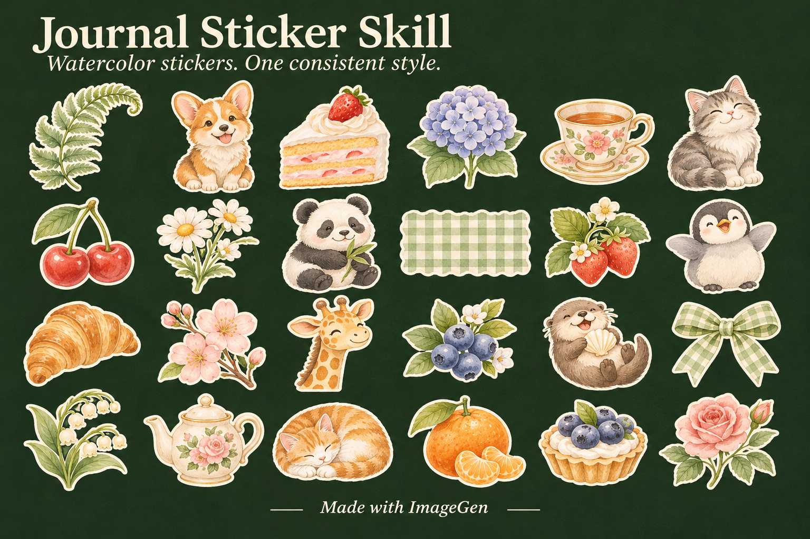
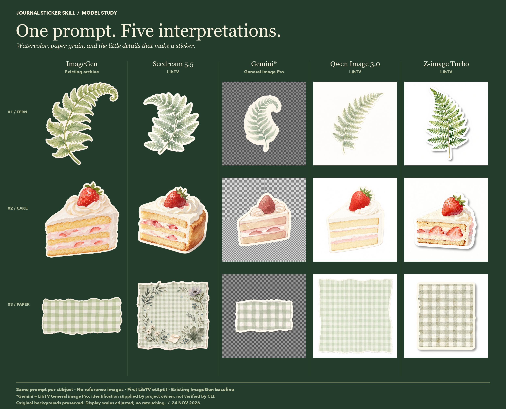

# Journal Sticker Generator

[简体中文](README.md) · [English](README.en.md) · [日本語](README.ja.md) · [한국어](README.ko.md)

A Codex skill for generating cohesive watercolor journal stickers with ImageGen. Style references, subject planning, and quality checks help new assets match an existing collection.



*This promotional showcase was newly generated in the same style. It is not a collage of all 99 original output files.*

<!-- model-comparison:start -->
## Same prompts · Five image sources

We reused three original ImageGen prompts with Seedream 5.5, Gemini* (LibTV: General image Pro), Qwen Image 3.0, and Z-image Turbo, then paired their first outputs with the archived ImageGen samples. The **forest matrix** is the selected comparison layout, with original backgrounds preserved.



[View the comparison, originals, settings, and methodology](docs/model-comparison/README.md)

*Gemini is the owner-supplied name; the CLI does not independently verify the upstream identity. ImageGen samples are archived, not regenerated. This is a sample study, not a model ranking.

<!-- model-comparison:end -->

## What’s included

- **99 prompts used in practice**: 25 each for nature, food, and paper decorations; 12 each for cats and dogs, and zoo animals.
- **3 style references**: a fern, strawberry cake, and gingham paper.
- **3 prompt templates**: starting without a reference, extending an existing style, and cute animals.
- **Generation rules**: separate outputs, complete silhouettes, transparent backgrounds, stable naming, and collection counts.
- **Quality checks**: outlines, anatomy, style consistency, transparency when composited, and thumbnail readability.

This repository includes the skill, prompts, reference images, and a showcase. It does not include the journal app’s source code or all 99 generated stickers.

## Installation

Download and extract the repository ZIP. Rename the folder containing `SKILL.md` to `journal-sticker-generator` and place it in your Codex skills directory. The default is `~/.codex/skills/`; if `CODEX_HOME` is set, use its `skills/` subdirectory.

```text
skills/
└── journal-sticker-generator/
    ├── SKILL.md
    ├── agents/openai.yaml
    └── references/
        ├── prompt-recipes.md
        ├── prompt-library.json
        └── style/
```

Your environment needs ImageGen image generation capabilities. The skill does not include a model, API keys, or generation credits. Other skill-compatible tools may require adapting the installation path and image tool interface.

## Example requests

```text
Use $journal-sticker-generator to create 12 cute watercolor cat and dog
stickers, 6 of each, as separate transparent PNGs. Match the paper texture
of the included references.
```

```text
Use $journal-sticker-generator to expand my nature collection to 24 stickers.
Count the existing assets first, use my image as the style reference,
and avoid repeating subjects.
```

```text
Use $journal-sticker-generator to create 8 cream and sage-green paper
stickers featuring polka dots, gingham, and labels, each with a transparent background.
```

## Workflow

1. Count existing assets, distinguish additions from the target total, and plan varied subjects.
2. Inspect and keep consistent style references; borrow their texture, not their subject.
3. Generate each asset separately with ImageGen and enable its transparent-background setting.
4. Check subjects, silhouettes, compositing, and small-size readability; retry specific defects.
5. Deliver individual PNGs, a manifest with relative paths, and the prompts actually used.

References and human selection matter too. Identical prompts do not guarantee pixel-identical results, and an alpha channel alone does not prove clean transparency.

## Files

- [Skill instructions](SKILL.md)
- [Reusable prompt templates](references/prompt-recipes.md)
- [99 original prompts](references/prompt-library.json)
- [Style references](references/style/)
- [Sharing and usage guide (Chinese)](分享使用说明.md)

## Scope and languages

This is a prompt-and-workflow skill, not an image model or a complete sticker asset pack. It targets standalone transparent PNG stickers. Seamless tape textures, UI screenshots, and vector icon systems are outside its default scope. The original style references and hero were generated with ImageGen; sources of the new comparison samples are documented in the model study.

READMEs are available in four languages. Skill instructions and supporting guides are currently mainly in Chinese; generation prompts are in English.
