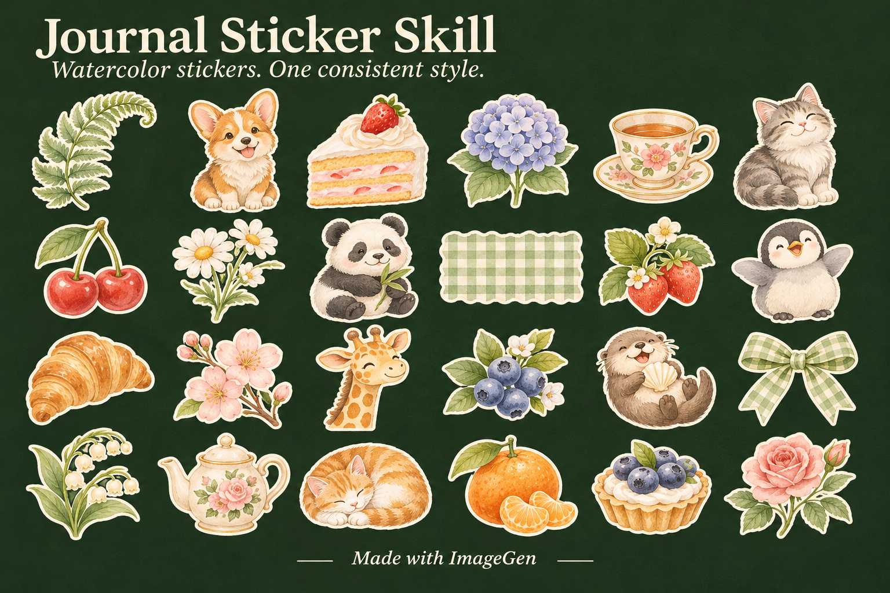
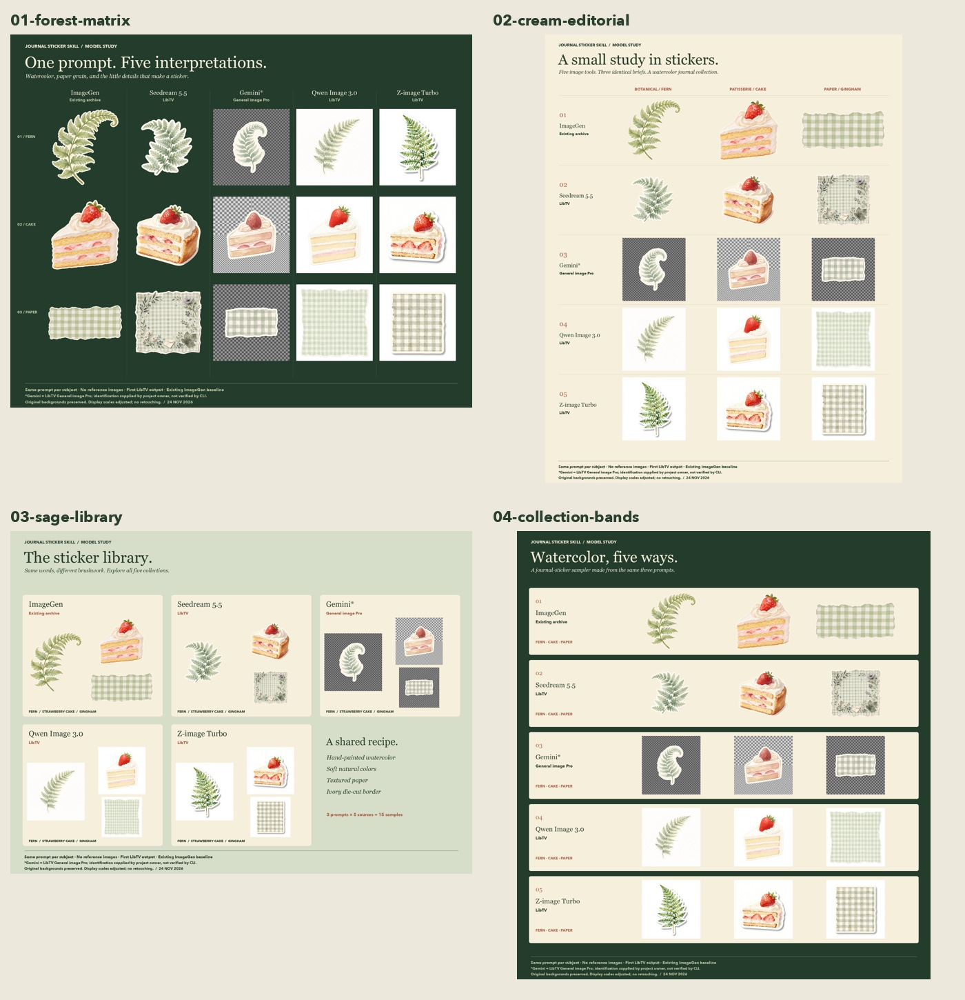

# Journal Sticker Generator

[简体中文](README.md) · [English](README.en.md) · [日本語](README.ja.md) · [한국어](README.ko.md)

ImageGen で、統一感のある水彩風の手帳用ステッカーを生成する Codex Skill です。画風の参考画像、モチーフの計画、品質チェックを組み合わせ、既存のシリーズに合う素材を追加できます。



*上の画像は、同じ画風で新たに生成した紹介用の画像です。元の生成素材 99 点をそのまま並べたものではありません。*

<!-- model-comparison:start -->
## 同じプロンプト · 5 種類の画像ソース

既存の ImageGen 画像に使った 3 件のプロンプトをそのまま使い、Seedream 5.5、Gemini*（LibTV：General image Pro）、Qwen Image 3.0、Z-image Turbo で生成しました。各モデルの最初の出力を既存の ImageGen 素材と並べた **4 種類のレイアウト案**です。元の背景を保持しています。



[4 案の拡大画像・元画像・設定・比較条件を見る](docs/model-comparison/README.md)

*Gemini はプロジェクト所有者が指定した名称です。CLI は上流モデルの名称を独立して確認できません。ImageGen は再生成せず既存画像を使用しています。モデルの総合順位を示すものではありません。

<!-- model-comparison:end -->

## 内容

- **実際に使用した 99 件のプロンプト**：自然・食べ物・紙素材が各 25 件、猫と犬・動物園の動物が各 12 件。
- **画風の参考画像 3 点**：シダ、いちごのケーキ、ギンガムチェックの紙。
- **プロンプトのテンプレート 3 種類**：参考画像なしでの生成、同じ画風での追加、かわいい動物。
- **生成ルール**：素材ごとの出力、見切れのない輪郭、透明背景、一貫した命名、点数の確認。
- **チェック方法**：輪郭、体の形、画風の統一感、背景に重ねた際の透明度、サムネイルでの見やすさ。

このリポジトリには Skill、プロンプト、参考画像、紹介用画像が含まれます。手帳アプリのソースコードや、生成済みステッカー全 99 点は含まれません。

## インストール

リポジトリの ZIP をダウンロードして展開し、`SKILL.md` が入っているフォルダーを `journal-sticker-generator` に変更して、Codex の skills ディレクトリに配置します。標準の場所は `~/.codex/skills/` です。`CODEX_HOME` を設定している場合は、その下の `skills/` を使用してください。

```text
skills/
└── journal-sticker-generator/
    ├── SKILL.md
    ├── agents/openai.yaml
    └── references/
        ├── prompt-recipes.md
        ├── prompt-library.json
        └── style/
```

実行環境には ImageGen の画像生成機能が必要です。この Skill 自体にモデル、API キー、生成クレジットは含まれません。他の Skill 対応ツールでは、配置先や画像生成ツールのインターフェースに合わせた調整が必要な場合があります。

## 使用例

```text
$journal-sticker-generator を使って、かわいい水彩風の猫と犬のステッカーを
各 6 点、合計 12 点生成してください。それぞれ独立した透明 PNG にして、
同梱の参考画像の紙の質感に合わせてください。
```

```text
$journal-sticker-generator を使って、自然シリーズを合計 24 点に増やしてください。
まず既存の素材を数え、私が提供する画像を画風の参考にして、
モチーフが重複しないようにしてください。
```

```text
$journal-sticker-generator を使って、クリーム色とセージグリーンの水玉、
チェック、ラベルの紙素材を 8 点生成してください。各画像の背景は透明にしてください。
```

## ワークフロー

1. 既存素材を確認し、追加する点数と最終的な総数を区別して、モチーフを計画します。
2. 参考画像を確認し、画風の基準を固定します。参考にするのは質感であり、モチーフそのものではありません。
3. 素材ごとに ImageGen を呼び出し、透明背景の設定を有効にします。
4. モチーフ、輪郭、背景に重ねた表示、小さいサイズでの見やすさを確認し、問題のある画像を再生成します。
5. 独立した PNG、相対パスの素材一覧、実際に使用したプロンプトを納品します。

参考画像と人による選別も重要です。同じプロンプトでも、ピクセル単位で同じ画像になるとは限りません。また、アルファチャンネルがあるだけでは、透明部分の品質は保証できません。

## ファイル一覧

- [Skill の手順](SKILL.md)
- [プロンプトのテンプレート](references/prompt-recipes.md)
- [実際に使用した 99 件のプロンプト](references/prompt-library.json)
- [画風の参考画像](references/style/)
- [共有・使用ガイド（中国語）](分享使用说明.md)

## 対象範囲と言語

これはプロンプトと作業手順をまとめた Skill であり、画像モデルや完成済みステッカー素材集ではありません。独立した透明 PNG ステッカーを対象とします。シームレスなテープ柄、UI スクリーンショット、ベクターアイコンの体系は標準の対象外です。元の参考画像とメイン画像は ImageGen で生成しました。追加の比較画像の出典はモデル比較ページに記載しています。

README は 4 言語に対応しています。Skill の手順と補足ガイドは現在主に中国語、画像生成用のプロンプトは英語です。
