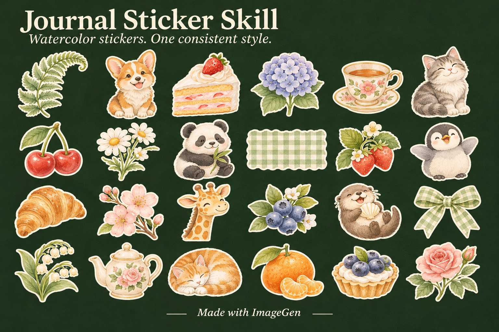

# Journal Sticker Generator

[简体中文](README.md) · [English](README.en.md) · [日本語](README.ja.md) · [한국어](README.ko.md)

ImageGen으로 일관된 수채화 스타일의 다이어리 스티커를 생성하는 Codex Skill입니다. 스타일 참고 이미지, 소재 기획, 품질 검사를 활용해 기존 시리즈와 어울리는 소재를 추가할 수 있습니다.



*위 이미지는 같은 스타일로 새롭게 생성한 홍보용 이미지입니다. 기존 결과물 99개를 그대로 모아 배치한 이미지는 아닙니다.*

## 포함된 내용

- **실제로 사용한 프롬프트 99개**: 자연·음식·종이 장식 각 25개, 고양이와 강아지·동물원 동물 각 12개.
- **스타일 참고 이미지 3개**: 고사리, 딸기 케이크, 깅엄 체크 종이.
- **프롬프트 템플릿 3종**: 참고 이미지 없이 시작하기, 같은 스타일로 확장하기, 귀여운 동물 만들기.
- **생성 규칙**: 개별 파일 출력, 잘리지 않는 실루엣, 투명 배경, 일관된 파일 이름, 시리즈별 개수 확인.
- **검사 방법**: 윤곽, 신체 형태, 스타일 일관성, 배경에 합성했을 때의 투명도, 썸네일 가독성.

이 저장소에는 Skill, 프롬프트, 참고 이미지, 홍보용 이미지가 들어 있습니다. 다이어리 앱의 소스 코드나 생성된 스티커 99개 전체는 포함하지 않습니다.

## 설치

저장소 ZIP 파일을 다운로드하고 압축을 풉니다. `SKILL.md`가 들어 있는 폴더 이름을 `journal-sticker-generator`로 바꾼 후 Codex의 skills 디렉터리에 넣으세요. 기본 경로는 `~/.codex/skills/`입니다. `CODEX_HOME`이 설정되어 있다면 그 아래의 `skills/`를 사용하세요.

```text
skills/
└── journal-sticker-generator/
    ├── SKILL.md
    ├── agents/openai.yaml
    └── references/
        ├── prompt-recipes.md
        ├── prompt-library.json
        └── style/
```

실행 환경에 ImageGen 이미지 생성 기능이 필요합니다. 이 Skill 자체에는 모델, API 키, 생성 크레딧이 포함되어 있지 않습니다. 다른 Skill 지원 도구에서는 설치 경로와 이미지 도구 인터페이스에 맞게 조정해야 할 수 있습니다.

## 사용 예시

```text
$journal-sticker-generator를 사용해 귀여운 수채화 고양이와 강아지 스티커를
각 6개씩, 총 12개 만들어 주세요. 각각 독립된 투명 PNG로 생성하고,
포함된 참고 이미지의 종이 질감을 유지해 주세요.
```

```text
$journal-sticker-generator를 사용해 자연 시리즈를 총 24개로 늘려 주세요.
먼저 기존 소재의 개수를 확인하고, 제가 제공한 이미지를 스타일 참고로 사용하되
소재가 중복되지 않도록 해 주세요.
```

```text
$journal-sticker-generator를 사용해 크림색과 세이지 그린 색상의 물방울무늬,
체크무늬, 라벨 종이 소재를 8개 만들어 주세요. 각 이미지의 배경은 투명하게 해 주세요.
```

## 작업 흐름

1. 기존 소재를 확인하고, 추가 개수와 최종 총개수를 구분해 다양한 소재를 기획합니다.
2. 참고 이미지를 살펴보고 스타일 기준을 유지합니다. 이미지 속 대상 자체가 아닌 질감과 화풍을 참고합니다.
3. 각 소재를 ImageGen으로 따로 생성하고 투명 배경 설정을 활성화합니다.
4. 대상, 윤곽, 배경 합성 결과, 작은 크기에서의 식별성을 확인하고 문제가 있는 이미지를 다시 생성합니다.
5. 개별 PNG, 상대 경로가 포함된 소재 목록, 실제 사용한 프롬프트를 제공합니다.

참고 이미지와 사람의 선별도 중요합니다. 같은 프롬프트가 픽셀 단위로 동일한 결과를 보장하지는 않습니다. 알파 채널이 있다는 사실만으로 투명 영역이 깔끔하다고 판단할 수도 없습니다.

## 파일 안내

- [Skill 작업 규칙](SKILL.md)
- [재사용 가능한 프롬프트 템플릿](references/prompt-recipes.md)
- [실제로 사용한 프롬프트 99개](references/prompt-library.json)
- [스타일 참고 이미지](references/style/)
- [공유 및 사용 안내（중국어）](分享使用说明.md)

## 적용 범위와 언어

이 프로젝트는 프롬프트와 작업 흐름을 담은 Skill이며, 이미지 모델이나 완성된 스티커 소재 모음이 아닙니다. 독립된 투명 PNG 스티커를 대상으로 합니다. 이음새 없이 반복되는 테이프 패턴, UI 스크린샷, 벡터 아이콘 체계는 기본 적용 범위에 포함되지 않습니다. 동봉된 이미지는 ImageGen으로 생성했습니다.

README는 4개 언어로 제공됩니다. Skill 작업 규칙과 보조 안내 문서는 현재 주로 중국어이며, 이미지 생성 프롬프트는 영어입니다.
