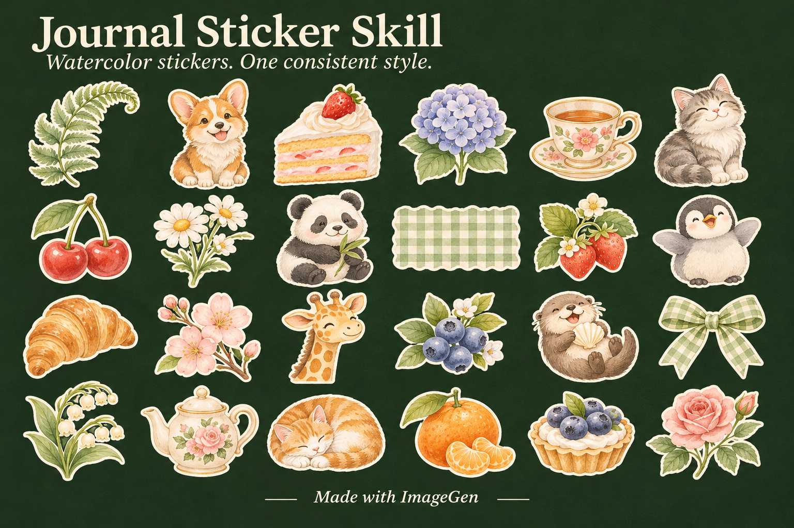
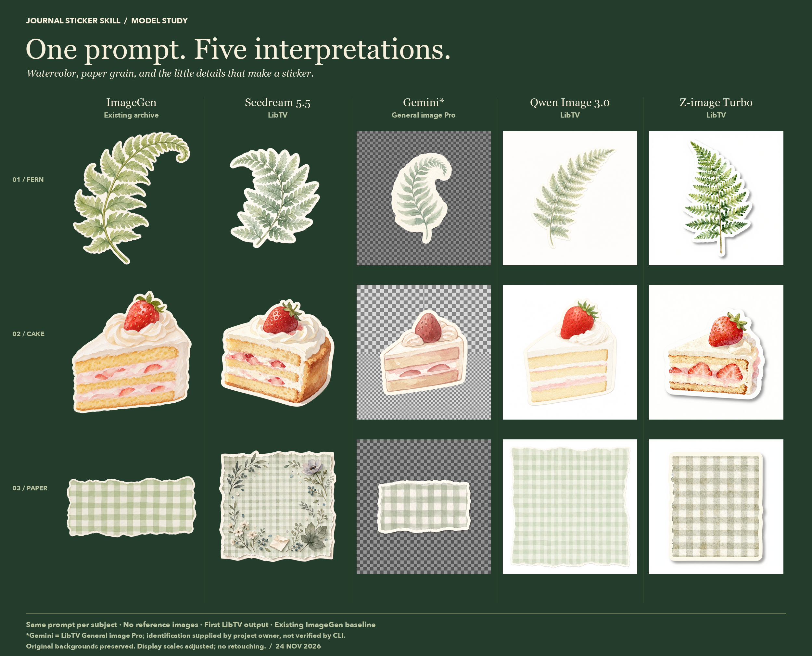

# Journal Sticker Generator

[简体中文](README.md) · [English](README.en.md) · [日本語](README.ja.md) · [한국어](README.ko.md)

用 ImageGen 生成成套水彩手账贴纸的 Codex Skill。通过风格参考图、主题规划和质量检查，让新增素材延续同一套画风。



*上图为参考同一画风新生成的宣传展示图，并非 99 张原始素材的逐张拼接。*

<!-- model-comparison:start -->
## 同 Prompt · 五组模型对比

复用已有 ImageGen 的三条原始 Prompt，测试 Seedream 5.5、Gemini*（LibTV：General image Pro）、Qwen Image 3.0 和 Z-image Turbo，再与原有 ImageGen 素材并排展示。采用 **深绿矩阵版**作为默认对比图，保留实际背景与首张输出。



[查看对比大图、原图、参数与测试说明](docs/model-comparison/README.md)

*Gemini 为项目所有者确认的名称；CLI 不独立验证上游身份。ImageGen 为既有样本，非本次重生成。此对比不是模型排行榜。

<!-- model-comparison:end -->

## 包含什么

- **99 条实际使用的提示词**：自然、美食、基础元素各 25 条，猫猫狗狗、动物园各 12 条。
- **3 张风格参考图**：蕨叶、草莓蛋糕、格纹纸片。
- **3 类提示词模板**：无参考图起始、同画风扩充、可爱动物。
- **生成规则**：每张独立输出、主体完整、透明背景、稳定命名和系列数量检查。
- **检查方法**：轮廓、肢体、画风一致性、真实透明合成和缩略图辨识度。

本仓库包含 Skill、提示词、参考图和展示图；不包含手账 App 源码或全部 99 张生成结果。

## 安装

下载仓库 ZIP 并解压，将包含 `SKILL.md` 的文件夹命名为 `journal-sticker-generator`，放入你的 Codex 技能目录。默认路径为 `~/.codex/skills/`；设置了 `CODEX_HOME` 时，使用其下的 `skills/`。

最终结构：

```text
skills/
└── journal-sticker-generator/
    ├── SKILL.md
    ├── agents/openai.yaml
    └── references/
        ├── prompt-recipes.md
        ├── prompt-library.json
        └── style/
```

运行环境需提供 ImageGen 图像生成能力。Skill 本身不包含模型、API 密钥或生成额度。其他支持 Skill 的工具可按其目录与图像工具接口适配。

## 使用示例

```text
使用 $journal-sticker-generator，生成 12 张可爱水彩猫狗贴纸，
猫狗各 6 张，每张独立透明 PNG，沿用包内参考图的纸张肌理。
```

```text
使用 $journal-sticker-generator，把我的自然系列扩充到 24 张。
先清点已有素材，以我提供的图为风格参考，避免重复主题。
```

```text
使用 $journal-sticker-generator，生成 8 张奶油色和鼠尾草绿的
波点、格纹、标签纸片，每张独立透明背景。
```

## 工作方式

1. 清点已有素材，区分新增数量和目标总数，规划不同主题。
2. 查看并固定画风参考，明确只参考质感，不复制主体。
3. 每个素材单独调用 ImageGen，同时启用透明背景参数。
4. 检查主体、轮廓、透明合成和小尺寸显示，针对缺陷重试。
5. 交付独立 PNG、相对路径清单和实际使用的提示词。

参考图和人工筛选同样重要。相同提示词不保证像素级复现；存在 alpha 通道也不等于透明边缘已经合格。

## 文件导航

- [Skill 工作规则](SKILL.md)
- [可复用提示词模板](references/prompt-recipes.md)
- [99 条原始提示词](references/prompt-library.json)
- [参考图](references/style/)
- [分享使用说明](分享使用说明.md)

## 适用范围

这是一个提示词与工作流程 Skill，面向独立透明 PNG 贴纸，不是图像模型或完整贴纸素材包。无缝胶带纹理、UI 截图和矢量图标系统不在默认范围内。原始参考图和主图由 ImageGen 生成；新增对比样本的来源见模型对比说明。

本项目提供四种语言的 README。Skill 工作规则和说明文档目前以中文为主，生成提示词为英文。
