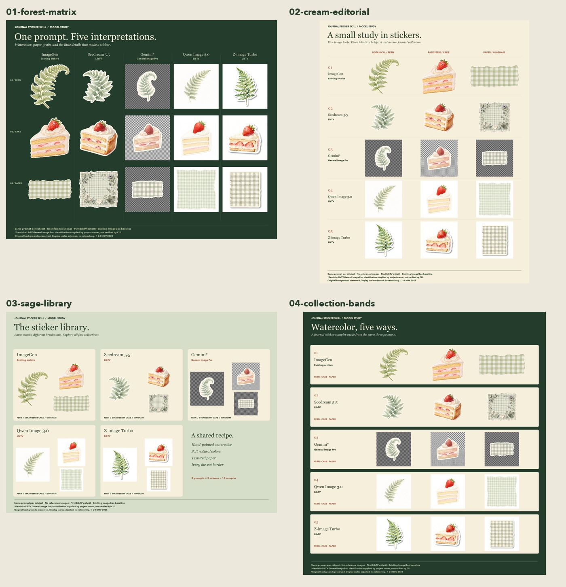
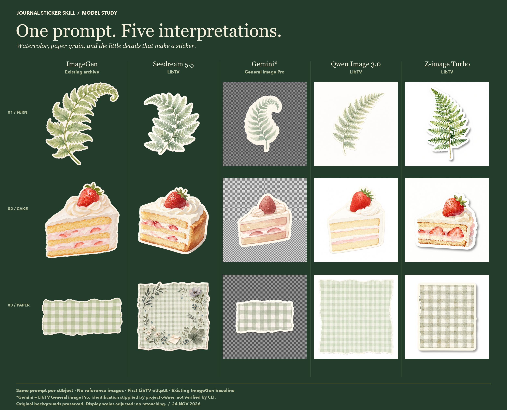
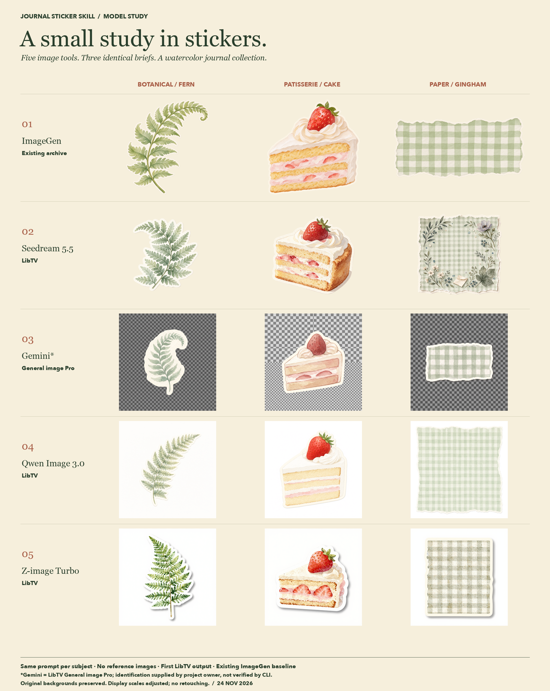
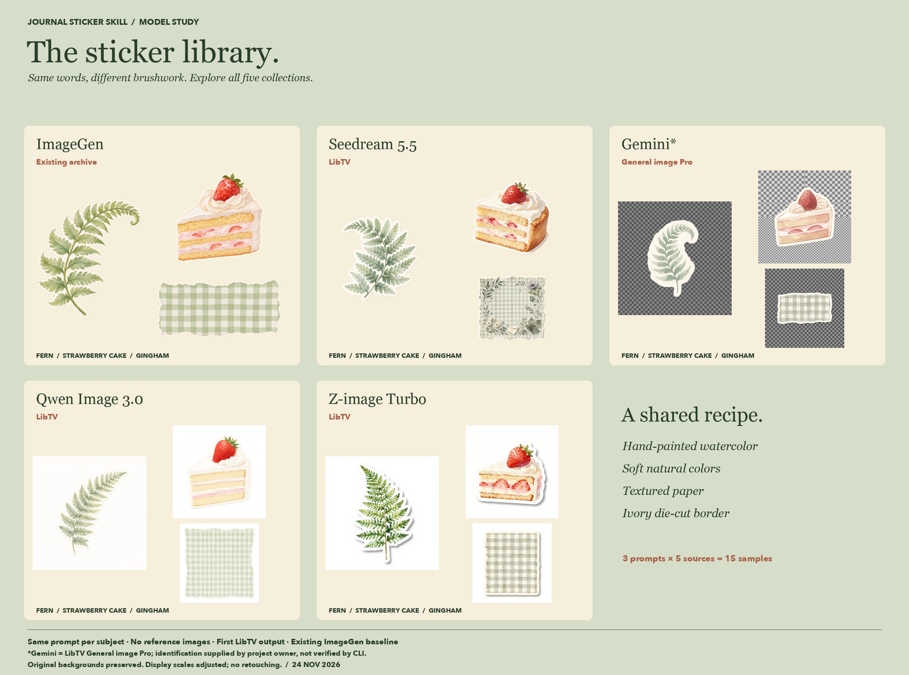
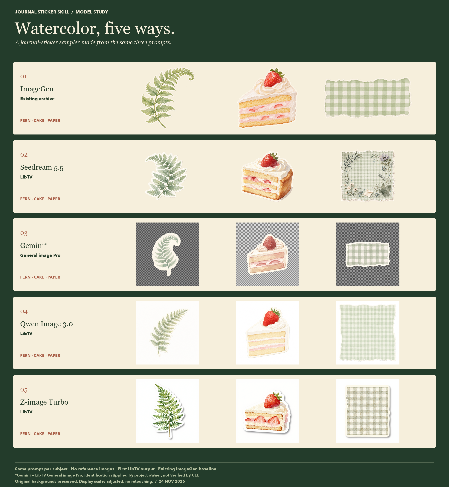

# Journal Sticker Skill · 同 Prompt 模型对比

本页提供四种候选排版，均使用相同的 **15 张真实样本**。原项目主图保持不变，候选图供选版。

| 版本 | 风格 | 原图 |
|---|---|---|
| 01 | 深绿主图矩阵：每列一个模型，每行一个主题 | [查看 PNG](01-forest-matrix.png) |
| 02 | 奶油色标本册：每行一个模型 | [查看 PNG](02-cream-editorial.png) |
| 03 | 鼠尾草绿素材卡：按模型分组收藏 | [查看 PNG](03-sage-library.png) |
| 04 | 深绿与奶油纸横条：适合竖向浏览 | [查看 PNG](04-collection-bands.png) |

## 输入与来源

- 测试日期：2026-11-24。
- 主题：蕨叶、草莓蛋糕、格纹纸片。每个主题的 Prompt 逐字复用已有 ImageGen 样本记录；主题之间的 Prompt 不同。
- 所有样本均不使用参考图。本次评估的是 Skill 的「无参考图起始素材」模板，不覆盖图生图、动物与系列扩充能力。
- 四个 LibTV 模型各新生成 3 张，count=1，请求方形 2K（Z-image 实际返回 1024×1024，其余为 2048×2048）；保留首张成功输出，没有审美重抽或择优。
- ImageGen 三张为已有本地素材，不重新生成。原始模型版本/seed 未记录，图片尺寸与本次 LibTV 方形输出不同，因此这是工作流样张对比，不是严格控制所有变量的模型排行榜。
- **Gemini** 按项目所有者确认的对应关系标注。LibTV 实际展示名为 **General image Pro**，接口 key 为 `nebula-ultra`；CLI 本身不能独立核实其上游模型厂商与具体版本。

## 实际设置

| 图中名称 | LibTV 展示名 / 来源 | 参数 |
|---|---|---|
| ImageGen | 已有本地 ImageGen 素材 | 当时启用 transparent_background；不重生成 |
| Seedream 5.5 | Seedream 5.5 | quality=2K, ratio=1:1, count=1, background=transparent |
| Gemini* | General image Pro | quality=2K, ratio=1:1, count=1, searchable=0 |
| Qwen Image 3.0 | Qwen image 3.0 | quality=std, resolution=2K, ratio=1:1, count=1 |
| Z-image Turbo | Z-image Turbo | quality=2K, ratio=1:1, count=1；实际返回 1024×1024 |

所有 Prompt 均要求透明背景；仅 Seedream 的这次 CLI schema 暴露独立透明背景选项，已启用。其他模型保留其实际输出，不能把视觉棋盘格当成透明通道。

## 透明通道检查

下表是各图 alpha=0 的像素占比（蕨叶 / 蛋糕 / 格纹）。它只是文件性质，不是综合质量评分，不能仅凭百分比判断抠图质量。

| 模型 | 完全透明像素占比 |
|---|---|
| ImageGen | 55.88% / 36.5% / 21.99% |
| Seedream 5.5 | 66.5% / 50.4% / 32.43% |
| Gemini | 0.0% / 0.0% / 0.0% |
| Qwen Image 3.0 | 0.0% / 0.0% / 0.0% |
| Z-image Turbo | 0.0% / 0.0% / 0.0% |

## 本次样本的可见差异

- **ImageGen 既有素材**：奶油色边框、柔和暖色与水彩纸纹较统一，三张均有真实透明区域。
- **Seedream 5.5**：本次三张均有真实透明区域；蛋糕层次清晰，但格纹纸片额外加入了花草和小信封，未完全遵循单纯格纹纸片的要求。
- **Gemini / General image Pro**：画面偏柔和插画，但三张都把灰色棋盘格画进了不透明图片；视觉上的棋盘格不是 alpha。
- **Qwen Image 3.0**：蕨叶较细、蛋糕较简洁，格纹纸片接近基础主题；三张均为不透明白底。
- **Z-image Turbo**：本次蕨叶更鲜绿，贴纸边缘有明显阴影感；三张均为不透明白底，且实际分辨率低于请求值。

以上是这 15 张图的观察，不外推为模型整体能力结论。

## 如何阅读这组图

注意水彩颜料与纸纹、轮廓完整性、奶油色描边、是否添加了未要求的内容，以及素材能否直接叠放在手账纸上。每个主题只有一个新样本，结论只针对本次输出。

排版保留整张原图的画布与 alpha，按比例缩放并居中；未调色、未抠图、未生成替代内容。原图若含白底或棋盘格，会原样显示。不同原始画布比例意味着主体在格内的视觉大小不完全一致。

- [三条完整 Prompt](prompts.json)
- [来源、设置、尺寸、透明比例与 SHA-256](manifest.json)
- [全部原始样本](assets/)

## Layout previews

### 01 · Forest matrix

### 02 · Cream editorial

### 03 · Sage library

### 04 · Collection bands

